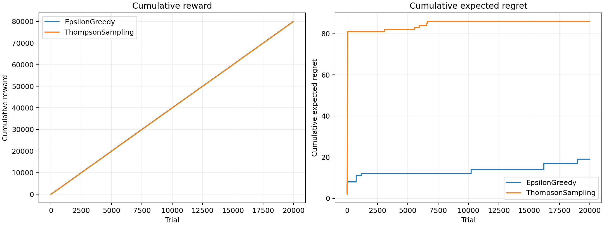
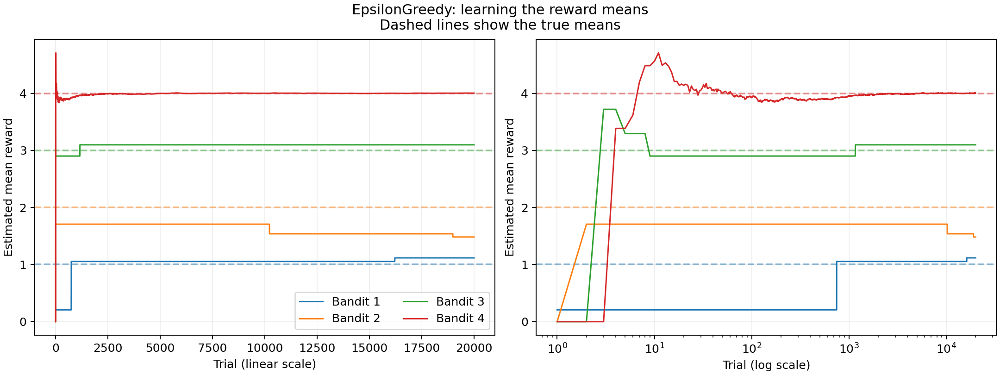
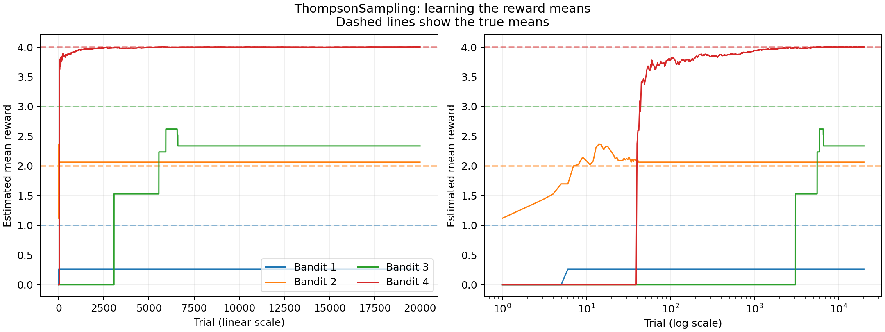

# Homework 2: A/B Testing

## 1. Experiment design

I compare epsilon-greedy and Thompson Sampling on four advertisements with true mean rewards [1, 2, 3, 4]. Each algorithm runs for 20,000 trials. Rewards are normally distributed with known precision 1, giving a reward variance of 1. This supports the requested known-precision model and reward means greater than 1.

Both policies use the same simulated reward table, generated with seed 2026. Each policy observes only the reward of its selected arm. Their selection rules use separate random generators, with seeds 42 and 43. True means are used to generate rewards and calculate regret, not to select an advertisement.

### Epsilon-greedy

I pull each arm once to initialize its estimate. Starting at trial 5, epsilon is 1/t, with trials numbered from 1. With probability epsilon, the algorithm chooses an arm uniformly at random. Otherwise, it chooses the arm with the largest sample mean, breaking ties randomly. Only the selected arm's running mean is updated.

### Thompson Sampling

Each unknown arm mean starts with a Normal prior with mean 0 and precision 1. On each trial, I sample from each arm's posterior and select the largest draw. After reward x is observed, the selected arm's posterior is updated as follows:

```text
new_precision = old_precision + reward_precision
new_mean = (old_precision * old_mean + reward_precision * x) / new_precision
```

The posterior standard deviation is 1/sqrt(new_precision). Other arms remain unchanged.

## 2. Results

Cumulative reward is the sum of observed rewards. Per-trial regret is 4 minus the selected arm's true mean. This measures expected reward lost through the choice of arm, without adding observation noise.

| Algorithm | Total reward | Mean reward | Total regret | Mean regret |
| --- | ---: | ---: | ---: | ---: |
| Epsilon-greedy | 80062.8648 | 4.003143 | 19 | 0.000950 |
| Thompson Sampling | 79997.6595 | 3.999883 | 86 | 0.004300 |



Epsilon-greedy selected bandit 4 on 19,990 trials; Thompson Sampling selected it on 19,955 trials. Epsilon-greedy had lower regret in this run. The reward curves nearly overlap because both policies spent almost all their trials on the best arm. The average observed reward can exceed 4 because individual rewards include normal noise.

<!-- pagebreak -->

## 3. Learning process

Each plot tracks all four estimated reward means. Dashed lines mark the true means. The logarithmic trial axis makes the early learning easier to see.





Both policies learn that bandit 4 is best. Some estimates for weaker arms remain far from their true means because those arms receive few observations. Accurate estimates for every arm are not necessary to earn high rewards once the best arm has been identified.

## Bonus: Better implementation plan

I would repeat the experiment across independent seeds and compare mean cumulative regret with uncertainty intervals. This run favors epsilon-greedy, but one run cannot establish which policy is generally better. Its fast epsilon decay can leave it exploiting a poor early estimate.

I would also compare the required 1/t schedule with min(1, c/t) for several values of c, chosen on separate simulation runs. A larger c keeps exploration active longer and may reduce the chance of committing to the wrong arm early.
