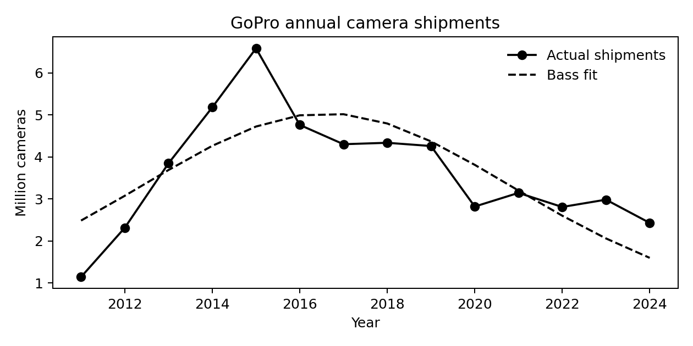
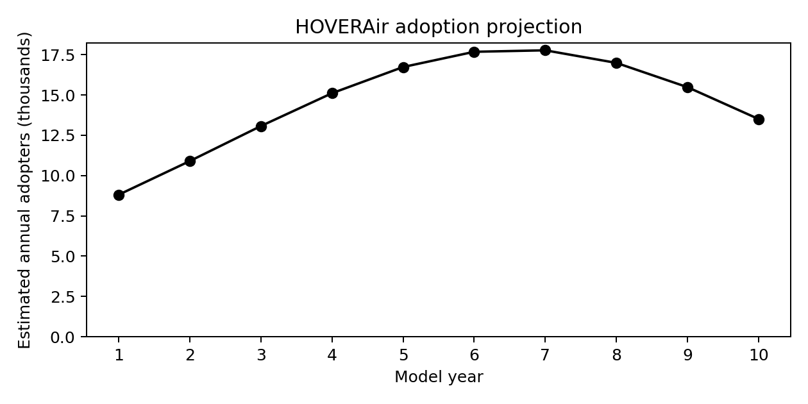

# Bass model: GoPro and HOVERAir

## 1. Product choice and scope

HOVERAir X1 ProMax is included in TIME's Best Inventions of 2025. It is a flying camera that follows users with AI tracking. GoPro action cameras are a historical comparison because both products help people record sports, travel and outdoor activities while participating in them. GoPro is worn or mounted, whereas HOVERAir flies alongside its user. Their shared use case and the visibility of footage to potential buyers provide a basis for using GoPro as a diffusion analogy. [1, 2, 10]

The technologies and adoption barriers differ. HOVERAir requires suitable flying conditions and confidence in autonomous tracking, while GoPro can be attached to the user or equipment. GoPro's data also span several camera generations rather than a single model. Its diffusion rates are therefore a working approximation for HOVERAir, not a demonstrated match. [2, 10]

I use a worldwide scope because the historical GoPro shipments and the creator population used to estimate HOVERAir's market are both global. The 14 annual observations cover 2011-2024 and measure camera shipments net of returns, not unique first-time owners. Source IDs and original filing locations are provided with the dataset and reference notes. [2-7, 9]

## 2. Estimating the Bass model

I follow the lecture's Method 1: fit annual sales using nonlinear least squares, with t = 1,...,14. The starting values are M = sum(sales), $p=0.02$ and $q=0.4$. I constrain the parameters to be positive. [8]

a(t) = M [(p+q)^2/p] exp(-(p+q)t) / [1 + (q/p) exp(-(p+q)t)]^2.

$M$ sets the market size, $p$ represents innovation influence, and $q$ represents imitation. The fit minimizes the sum of squared differences between observed and predicted annual shipments. With data in millions, $M$ is also in millions.

The estimates are **M = 56.46 million camera units, p = 0.0347 and q = 0.2831**. The fit has **R-squared = 0.60** and **RMSE = 0.85 million cameras**. It follows the broad rise and decline but misses the sharp 2015 peak, so the fit is moderate. Because q exceeds p, the fitted model places more weight on imitation than innovation influence.

## 3. HOVERAir market potential

Following the lecture's new-product approach, I use GoPro's fitted p and q and estimate HOVERAir's M separately. Goldman Sachs reported an estimated **50 million global creators in 2023**. I use that dated population as the starting point without assuming growth. [8, 9]

For a Fermi estimate, I assume 10% regularly need outdoor or travel footage, 20% of that group are willing and able to buy a premium flying camera, and 20% of those choose X1 ProMax. The outdoor use case motivates the first restriction; the announced USD 699 MSRP and practical flight constraints motivate the second; competing filming options motivate the third. These percentages are author assumptions, not published statistics. The sources support the starting population and product context, not the percentages. [1, 9, 10]

M = 50,000,000 x 0.10 x 0.20 x 0.20 = **200,000 eventual buyers**.

This estimates the global creator segment only, excludes non-creator buyers, and assumes one first purchase per person.

## 4. Adoption forecast

I apply the lecture's annual-sales approximation Mf(t), using M = 200,000 and the fitted p and q. The table covers ten model years from an assumed zero-adoption origin. These are illustrative model years rather than a forecast calibrated to actual HOVERAir sales. [8]

| Model year | Estimated annual adopters |
| --- | ---: |
| 1 | 8,809 |
| 2 | 10,897 |
| 3 | 13,070 |
| 4 | 15,108 |
| 5 | 16,734 |
| 6 | 17,680 |
| 7 | 17,771 |
| 8 | 16,989 |
| 9 | 15,482 |
| 10 | 13,505 |

The projection rises to approximately **17,800 annual adopters in model year 7**, then declines.

The main limitations are GoPro's repeat purchases and channel inventory, adoption before the dataset starts in 2011, and the assumed HOVERAir market fractions. A single camera model may also be replaced during the ten-year horizon. The forecast is conditional on these assumptions and on HOVERAir following GoPro's diffusion rates.

## References

Sources checked October 8-9, 2026. Filing table locations are in [references/sources.md](../references/sources.md).

1. Mateo, A. (2025, October 9). [HoverAir X1 ProMax](https://time.com/collections/best-inventions-2025/7318494/hoverair-x1-promax/). TIME.
2. GoPro. (2014). [Form S-1](https://www.sec.gov/Archives/edgar/data/1500435/000119312514204902/d552193ds1.htm), pp. 55-56.
3. GoPro. (2017). [FY2016 Form 10-K](https://www.sec.gov/Archives/edgar/data/1500435/000150043517000013/gpro2016-12x3110xk.htm), p. 39.
4. GoPro. (2019). [FY2018 Form 10-K](https://www.sec.gov/Archives/edgar/data/1500435/000150043519000013/gpro2018-12x3110xk.htm), p. 48.
5. GoPro. (2021). [FY2020 Form 10-K](https://www.sec.gov/Archives/edgar/data/1500435/000150043521000020/gpro-20201231.htm), p. 49.
6. GoPro. (2022). [FY2021 Form 10-K](https://www.sec.gov/Archives/edgar/data/1500435/000150043522000016/gpro-20211231.htm), MD&A, Revenue.
7. GoPro. (2025). [FY2024 Form 10-K](https://www.sec.gov/Archives/edgar/data/1500435/000162828025013046/gpro-20241231.htm), p. 41.
8. Hovhannisyan, K. (n.d.). [Bass Model for Innovation Diffusion](../references/DS-223-Bass-model.pdf). DS 223, AUA. Slides 34 and 40 (PDF pages 45 and 51).
9. Goldman Sachs. (2023, April 19). [The creator economy could approach half-a-trillion dollars by 2027](https://www.goldmansachs.com/insights/articles/the-creator-economy-could-approach-half-a-trillion-dollars-by-2027). Creator estimate only; the three fractions are author assumptions.
10. HOVERAir. (2024, August 26). [X1 Pro / ProMax launch campaign](https://hoverair.com/blogs/news/hoverair-launches-worlds-first-8k-flying-action-camera). Campaign date and announced MSRP.
